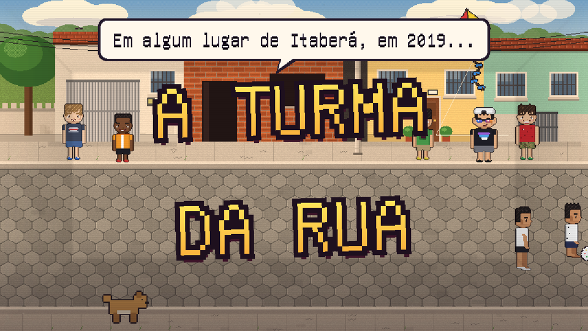
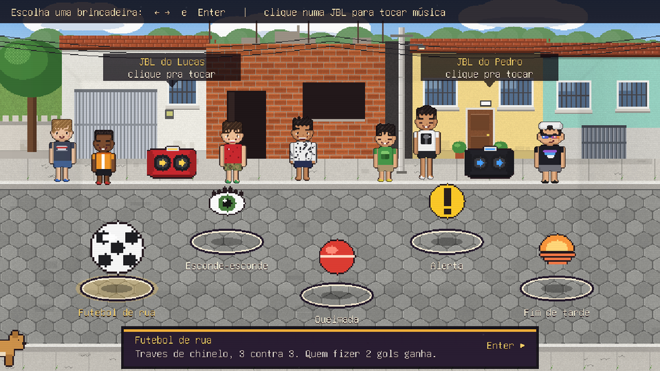
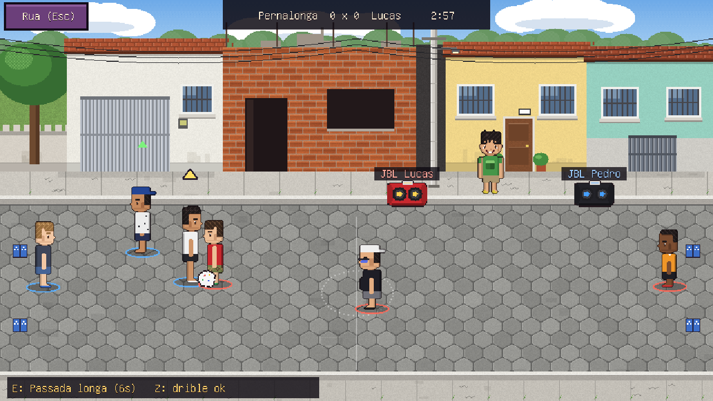
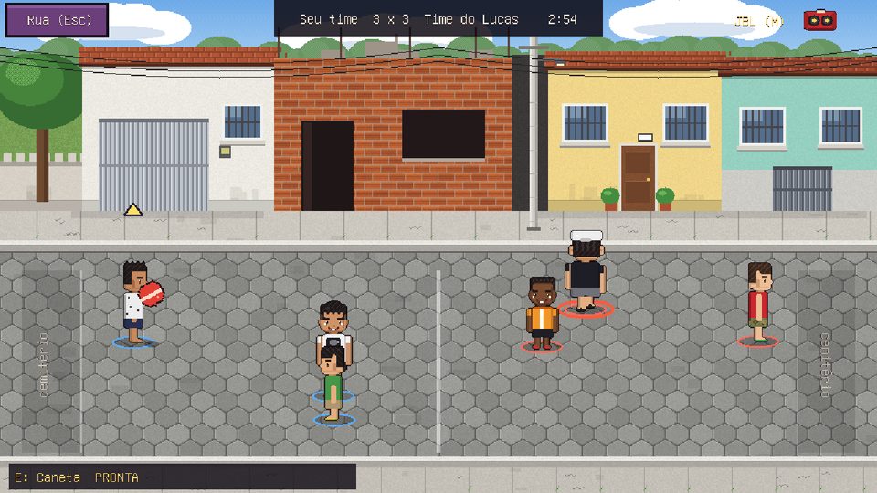
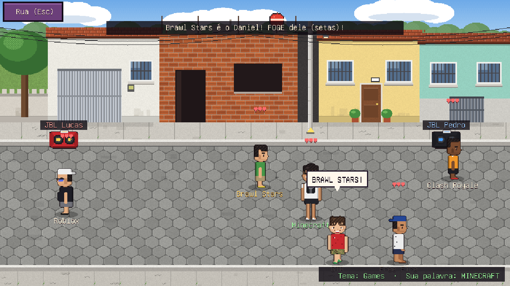
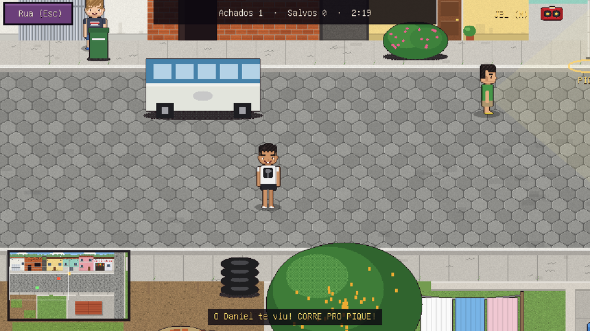
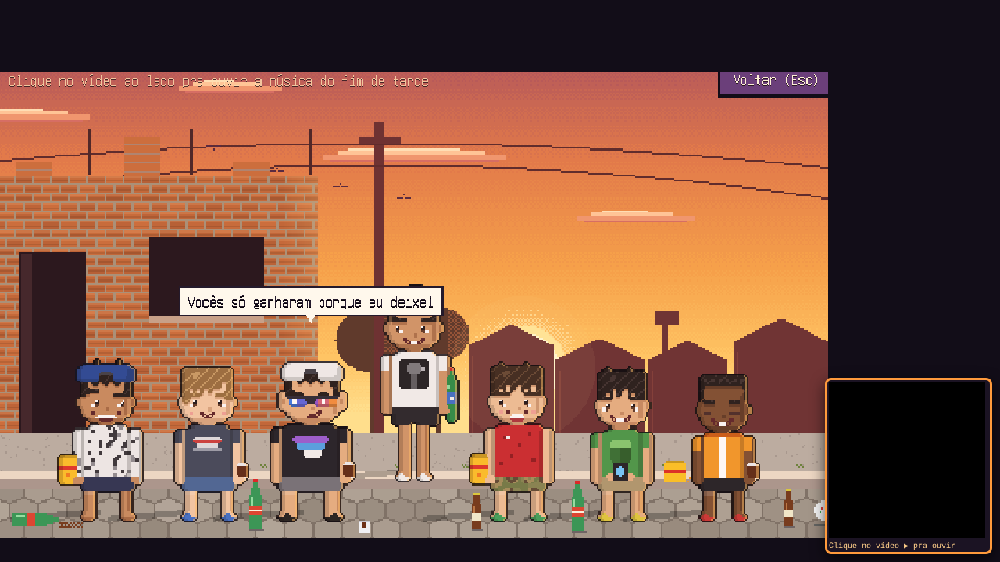

# A Turma da Rua

> *Em algum lugar de Itaberá, em 2019...*

Um jogo indie em pixel art sobre uma tarde de brincadeiras na rua com sete amigos de infância. Tem futebol com traves de chinelo, esconde-esconde no quarteirão inteiro, queimada e alerta. A JBL do Lucas ou a do Pedro toca as músicas da época, e no fim a turma senta no meio-fio para ver o pôr do sol.

## 🎮 [Jogar agora](https://moralez2005.github.io/Turma-da-Rua/)



## Brincadeiras

| | Brincadeira | Como funciona |
| --- | --- | --- |
| ⚽ | **Futebol de rua** | 3 contra 3 com traves de chinelo. A bola sobe, quica e rola. Passe, chute carregado, troca de jogador e habilidades. Antes do jogo você monta os times e escolhe o tempo, quantos gols pra vencer e o clima. Passa carro (e às vezes um Fusca azul: aperta F!), pode cair uma chuva que manda todo mundo pro barracão, e as vizinhas participam: a Dona Tita devolve a bola e oferece água, e a Dona Vera reclama do portão, demora pra devolver... e se a filha dela pegar a bola, ela fura e acabou o jogo. |
| 👁 | **Esconde-esconde** | O quarteirão inteiro, desenhado a partir do mapa da rua de verdade: a rua principal, as duas ruas que sobem (a do Cezar e do Lucas) e a descida até a casa do Pernalonga. Tem a escadinha do Kauã, o barracão inacabado sem telhado, o portão de madeira do Pedro, as casas da Dona Tita e da Dona Vera e mais de 30 esconderijos. Você pode se esconder enquanto o Daniel procura, ou procurar a turma. |
| 🔴 | **Queimada** | Seu time contra o time do Lucas. Mire, carregue e arremesse. Agarre a bola na hora certa. Quem é queimado vai pro cemitério e volta se queimar alguém de lá. |
| ❗ | **Alerta** | Escolha um tema (frutas, times, países, games...) e a sua palavra. Gritaram a sua? Corre pegar a bola e grita ALERTA! Todo mundo congela, você dá 3 passos e arremessa. 3 vidas cada. |
| 🌅 | **Fim de tarde** | A cena final: a turma no meio-fio, refri e salgadinho, pôr do sol e uma frase pra fechar. |



| Futebol | Queimada |
| --- | --- |
|  |  |
| **Alerta** | **Esconde-esconde** |
|  |  |



## A turma

Antes de cada brincadeira você escolhe com quem joga. No futebol e na queimada, dá pra montar os dois times com qualquer um da turma (ou sortear); no futebol o 1º de cada time ataca, o 2º defende e o 3º vai pro gol. Quem fica de fora assiste da calçada.


| Personagem | Habilidade no futebol (tecla E) |
| --- | --- |
| **Pernalonga** | Passada longa: corre muito mais rápido (no Alerta, dá 4 passos em vez de 3) |
| **Cezar** | Caneta: arrancada rápida, e ninguém rouba a bola dele |
| **Kauã Henrique** | Paredão: goleiro que alcança mais longe |
| **Pedro** ("Dona Juliete") | Bomba: o próximo chute ou arremesso sai fortíssimo |
| **Lucas** | Zoeira: deixa quem está perto mais lento |
| **Daniel** | Estrategista: mostra onde está o alvo ou o escondido mais perto |
| **Gabriel** | Gato: pulo de goleiro mais rápido |

Na queimada as habilidades são outras, próprias do jogo: Braço longo (Pernalonga), Ginga (Cezar), Mira calculada (Daniel), Zoeira (Lucas), Bomba do MC (Pedro) e Mão de goleiro (Gabriel).

## Controles

| Tecla | Ação |
| --- | --- |
| Setas / WASD | Andar |
| Espaço | Passe (futebol) · arremessar ou agarrar (queimada) · agachar ou "Achei!" (esconde) |
| Shift | Chute carregado (futebol) · correr (esconde) |
| C | Passe por cima (futebol) |
| Z | Drible / finta (futebol) |
| 1 a 7 | Escolher tema e palavra (alerta) |
| E | Habilidade do personagem |
| Q | Trocar jogador ou alvo |
| F | Gritar "FUSCA AZUL!" quando um Fusca azul passar (quem gritar primeiro dá o peteleco) |
| T | Atender o orelhão (esconde-esconde) |
| M | Tocar ou pausar a Rádio da Rua |
| Esc | Voltar para a rua |

**Rádio da Rua:** uma barra fica suspensa no topo da tela o tempo todo. Escolha a JBL do Lucas (eletrônica, gringas e o rap do Minecraft) ou a do Pedro (funk) ali em cima, ou clique numa JBL no cenário. O player oficial do YouTube fica pendurado ao lado do jogo, com a lista de músicas, e a música continua tocando nas brincadeiras. O botão ▴ pausa e recolhe o player.

**Fusca azul:** o placar de petelecos dados e levados aparece no menu da rua e fica guardado no navegador.

**Orelhão:** no esconde-esconde, aperte T perto do orelhão pra ele tocar: um trim-trim e uma musiquinha 8-bit original, feita por código (`ferramentas/gerador/orelhao.py`), sem precisar do YouTube.

**Vizinhas:** os nomes são inventados e tudo delas (nome, cor, falas, demora e chance de furar a bola) fica em `src/vizinhas.js`.

**Adicionar músicas:** edite `src/data/radio.json`. Cada música tem `titulo`, `artista` e `videoId`, que é o código depois de `v=` no link do YouTube ou depois de `youtu.be/`, sem o `?si=...`. Músicas em `sem_link` ainda não tocam: quando achar o vídeo, mova a linha pra `musicas`.

## Rodar no computador

```
python -m http.server 8000
```

Depois, abra `http://localhost:8000`. Abrir o `index.html` com dois cliques não funciona, porque o navegador bloqueia a leitura dos arquivos.

Para abrir direto numa brincadeira: `http://localhost:8000/?cena=Futebol`. Também funciona com `Queimada`, `Alerta`, `EscondeEsconde` e `Final`.

## Como foi feito

- **Motor:** [Phaser 3.87](https://phaser.io), que já vem em `lib/`, sem build e sem CDN.
- **Arte:** pixel art gerada por scripts em Python (Pillow/numpy) em `ferramentas/gerador/`. Isso inclui sprites em 4 direções, cenários em 960×540, o mapa de 1920×1440 do esconde-esconde (`esconde_mapa_real.py`) e os objetos. A única foto é a da homenagem no final: a turma de verdade.
- **Sons:** efeitos retrô, o toque do orelhão e a chuva, todos sintetizados por código (`ferramentas/gerador/sons.py`, `orelhao.py` e `chuva.py`).
- **Fonte:** Unifont, renderizada como fonte bitmap.

### Feito com IA

O jogo foi desenvolvido com ajuda de inteligência artificial, e eu dirigi cada etapa: as memórias, a turma, as brincadeiras e o tom vieram de mim, e a IA ajudou a transformar tudo em código e arte.

- **IBM Bob:** criou a primeira versão do jogo (estrutura em Phaser, cenas e rádio) a partir do meu documento de design, em `docs/design.md`. Os prompts que usei estão no fim desse documento.
- **Claude (Anthropic):** gerou as artes e os sons por script, revisou o código, reescreveu as brincadeiras pra deixar tudo jogável e fez as melhorias finais: a Rádio da Rua no topo, o Alerta corrigido e os balões de fala que não se sobrepõem mais.

## Créditos

- **A turma:** Pernalonga, Cezar, Kauã Henrique, Pedro, Lucas, Daniel e Gabriel.
- **Músicas:** tocadas pelo player oficial do YouTube, sem cópia do áudio. Todos os direitos reservados aos autores. A lista está em `src/data/radio.json`.
- **Frase final:** "Algo que não muda com o tempo é a memória dos dias de juventude." Sheik, *The Legend of Zelda: Ocarina of Time* (Nintendo).
- **Inspiração:** *Zueirama*.
- **Workshop:** IBM SkillsBuild · #IBMBOB

## Licença

O código está sob a licença MIT (veja [LICENSE](LICENSE)). Músicas, frase e obras citadas pertencem aos seus autores.
